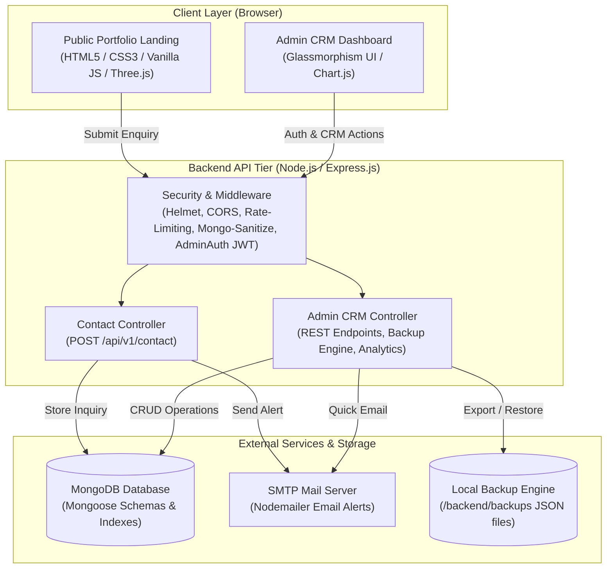

# HM Portfolio & Enterprise CRM Workspace

[](LICENSE)
[](https://nodejs.org/)
[](https://expressjs.com/)
[](https://www.mongodb.com/)
[](https://www.docker.com/)

A modern, production-grade, highly secure full-stack developer portfolio and Enterprise CRM & SRE Operations Workspace built for **Sudalaimuthu A**.

This project pairs an interactive, WebGL 3D-enhanced, AI-guided public portfolio landing page with a robust Node.js/Express REST API backend and a dark glassmorphic Admin CRM Dashboard for managing client leads, project pipelines, system analytics, and disaster recovery.

---

## 📋 Table of Contents

- [Overview](#overview)
- [Key Features](#key-features)
  - [Public Portfolio](#public-portfolio)
  - [Admin CRM Enterprise Portal](#admin-crm-enterprise-portal)
- [Tech Stack](#tech-stack)
- [System Architecture](#system-architecture)
- [Project Structure](#project-structure)
- [Local Installation & Setup](#local-installation--setup)
- [Docker Deployment](#docker-deployment)
- [Environment Variables](#environment-variables)
- [API Documentation](#api-documentation)
- [Database & Disaster Recovery](#database--disaster-recovery)
- [Authentication & Security](#authentication--security)
- [Testing & Health Diagnostics](#testing--health-diagnostics)
- [License](#license)
- [Author & Contact](#author--contact)

---

## 🔍 Overview

The application is structured into two main tiers:
1. **Public Portfolio Interface**: A client-facing single-page application featuring mobile-first responsive design, interactive 3D WebGL background effects, a neural particle canvas, a conversational AI Assistant with Command Palette support (`Ctrl+K`), an interactive project search/filter engine, and an automated inquiry submission workflow.
2. **Admin CRM Enterprise Portal**: A secure management workspace for administrators to review incoming client inquiries, track pipeline status on a drag-and-drop Kanban board, schedule follow-ups, attach documents, compose quick email responses via SMTP, visualize analytics via Chart.js, and perform database backup/restoration operations.

---

## ✨ Key Features

### Public Portfolio
- **Cinematic WebGL & Canvas Visuals**: Three.js-rendered 3D hero geometry (`three-scene.js`) and an interactive neural network particle backdrop (`neural-network.js`) responsive to mouse movements.
- **Conversational AI Guide & Command Palette**: Interactive AI modal console (`ai-assistant.js`) with keyboard shortcut support (`Ctrl+K`), quick navigation commands, voice recognition, and text-to-speech toggles.
- **Interactive Technical Arsenal**: Categorized skills showcase highlighting Frontend, Backend, Database, and Tooling capabilities using Devicons.
- **Services & Value Propositions**: Glassmorphic layout cards outlining freelance capabilities, business solutions, and technical standards.
- **Project Explorer**: Real-world project showcase equipped with real-time text search and technology stack filtering buttons (HTML5, Vanilla JS, Node.js, MongoDB).
- **CV / Resume Downloads**: Direct view and download controls for verified resume documents (`public/resume/resume.pdf`).
- **Contact Enquiry Engine**: Secure contact form submitting inquiries directly to the Express REST API with client-side validation and toast alerts.
- **OS Telemetry HUD**: System clock and telemetry header status bar with theme state toggling (Dark/Light mode).

### Admin CRM Enterprise Portal
- **Secure Authentication & Session Management**: Dedicated admin login interface with rate-limiting protection, brute-force lockout safeguards, httpOnly cookie JWT refresh token rotation (RTR), and bearer token fallbacks.
- **Interactive Dashboard Overview**: System summary cards displaying total messages, pending leads, completed items, system uptime, and activity alerts.
- **Client Workspace & Message Inbox**: Tabbed client profile drawer supporting:
  - **Details**: Full client submission metadata and status management (`New`, `In Progress`, `Replied`, `Completed`, `Archived`).
  - **Internal Notes**: Private admin comment thread per inquiry.
  - **Task Checklist**: Dynamic task items with toggleable completion states for client projects.
  - **Secure Attachments**: Document uploader supporting Base64 document storage up to 2MB.
  - **Quick Email Sender**: Integrated email composer sending quick responses directly via SMTP (`Nodemailer`).
  - **Audit Timeline**: Historical timestamped event log tracking status changes and administrative edits.
- **Bulk Actions & Data Export**: Multi-selection actions for updating status categories and exporting records to CSV or JSON.
- **Drag-and-Drop Kanban Pipeline**: Drag-and-drop workflow board for tracking inquiry progression across workflow stages.
- **Follow-up Calendar**: Integrated CRM calendar grid for mapping follow-up commitments and deadlines.
- **Chart.js Analytics Engine**: Interactive charts summarizing inquiry velocity, lead conversion ratios, budget distributions, and project category breakdowns.
- **Disaster Recovery & SRE Controls**: In-app interface for triggering JSON schema database backups, inspecting backup points, and performing schema restorations.

---

## 🛠️ Tech Stack

### Frontend
- **HTML5 & CSS3**: Custom CSS variables, responsive Flexbox/Grid layouts, glassmorphism design system.
- **Vanilla JavaScript (ES6+)**: Modular scripts without external UI dependencies.
- **Three.js (r128)**: WebGL 3D particle and geometric mesh rendering.
- **Chart.js (v4.4.2)**: Interactive CRM data visualization.
- **Devicon & Google Fonts**: Typography (Outfit font family) and technical icon sets.

### Backend
- **Node.js (v18+ / v22)**: JavaScript runtime environment.
- **Express.js (v4.19)**: HTTP web application framework.
- **Mongoose (v8.4)**: Object Data Modeling (ODM) library for MongoDB.
- **Nodemailer (v6.9)**: Asynchronous SMTP email transport service.
- **Morgan**: HTTP request logger middleware.

### Database
- **MongoDB**: MongoDB Atlas cloud database cluster or local MongoDB Community Server.

### Authentication & Security
- **JSON Web Tokens (`jsonwebtoken` v9.0)**: Secure authentication token engine with Refresh Token Rotation (RTR).
- **`bcryptjs` (v3.0)**: Cryptographic password hashing.
- **Helmet (v7.1)**: HTTP security headers and custom Content Security Policy (CSP).
- **Express Rate Limit (v7.2)**: Rate-limiting middleware for DDoS and brute-force prevention.
- **Express Mongo Sanitize (v2.2)**: Sanitization of user-supplied data to prevent NoSQL operator injection.
- **HPP (v0.2)**: Protection against HTTP Parameter Pollution.
- **Cookie Parser**: Cookie parsing for httpOnly session management.

### DevOps & Deployment
- **Docker**: Multi-stage Docker build utilizing `node:22-alpine`.
- **Docker Compose**: Container service orchestration with volume mounts for logs and backups.
- **GitHub Actions**: Automated CI pipeline verifying Node 22 dependency installation and script syntax (`.github/workflows/ci-cd.yml`).
- **Netlify**: Frontend static configuration (`frontend/netlify.toml`).

---

## 🏗️ System Architecture



---

## 📁 Project Structure

```text
.
├── .github/
│   └── workflows/
│       └── ci-cd.yml             # Automated CI pipeline
├── docs/                         # Architecture guides & documentation
├── frontend/                     # Static Frontend Client Application
│   ├── css/                      # Portfolio stylesheet (style.css)
│   ├── js/                       # Modular scripts (main.js, ai-assistant.js, three-scene.js, etc.)
│   ├── public/                   # Media assets & resume document
│   │   ├── images/               # Profile & background images
│   │   └── resume/               # PDF resume file (resume.pdf)
│   ├── admin/                    # Admin CRM Portal
│   │   ├── css/                  # CRM stylesheet (admin.css)
│   │   ├── js/                   # Split admin JS modules (api.js, dashboard.js, messages.js, kanban.js, etc.)
│   │   ├── dashboard.html        # Main CRM Workspace layout
│   │   └── index.html            # Admin login interface
│   ├── favicon.ico
│   ├── manifest.json             # Web application manifest
│   ├── netlify.toml              # Netlify hosting rules
│   ├── robots.txt
│   ├── service-worker.js
│   └── index.html                # Portfolio landing index page
├── backend/                      # Node.js / Express.js REST API Server
│   ├── config/                   # MongoDB connection & environment checkers
│   ├── controllers/              # Contact & Admin CRM business logic
│   ├── middleware/               # CORS, Rate Limiting, Validation, Auth & Error Handling
│   ├── models/                   # Mongoose schemas (Contact, ContactCrmMeta, Auth/Lockout logs)
│   ├── routes/                   # API Routers (/v1/contact, /v1/admin)
│   ├── services/                 # Email, Analytics, Visitor & Backup services
│   ├── utils/                    # ApiError, Logger utilities
│   ├── .env.example              # Environment variables template
│   ├── package.json              # Backend dependencies & script definitions
│   └── server.js                 # Express Application Entrypoint
├── Dockerfile                    # Multi-stage Alpine containerization build
├── docker-compose.yml            # Docker Compose runtime definition
├── LICENSE                       # MIT License
└── README.md                     # Project documentation manual
```

---

## 🚀 Local Installation & Setup

### Prerequisites
- **Node.js**: v18.x or higher (v22 recommended)
- **MongoDB**: Local MongoDB Community instance or a MongoDB Atlas cluster URI
- **Docker**: (Optional) For running containerized services

### Step-by-Step Setup

1. **Clone the Repository**:
   ```bash
   git clone https://github.com/thronmuthu18/portfolio.git
   cd portfolio
   ```

2. **Configure and Run the Backend API**:
   ```bash
   # Navigate to the backend directory
   cd backend

   # Install dependencies
   npm install

   # Create your environment file from the template
   cp .env.example .env
   ```

   Open `.env` and fill in your MongoDB connection string and SMTP details (see [Environment Variables](#environment-variables)).

   Start the server:
   ```bash
   # Development mode with nodemon hot-reload
   npm run dev

   # Production mode
   npm start
   ```
   The backend API will run at `http://localhost:5000`.

3. **Launch the Frontend**:
   Serve the `/frontend` directory using any HTTP server solution (such as VS Code Live Server or `npx serve`):
   ```bash
   # Example using npx serve from the project root
   npx serve frontend -p 5500
   ```
   - **Public Portfolio**: Access at `http://localhost:5500/index.html`
   - **Admin Login**: Access at `http://localhost:5500/admin/index.html`
   - **Admin CRM Workspace**: Access at `http://localhost:5500/admin/dashboard.html`

---

## 🐳 Docker Deployment

The application includes a multi-stage `Dockerfile` and `docker-compose.yml` for isolated containerized environments.

### Running with Docker Compose

1. Build and boot containers in detached mode:
   ```bash
   docker-compose up --build -d
   ```

2. Check running container status:
   ```bash
   docker-compose ps
   ```

3. Stream container logs:
   ```bash
   docker-compose logs -f crm-server
   ```

4. Stop running containers:
   ```bash
   docker-compose down
   ```

---

## 🔐 Environment Variables

Create a `.env` file in the `backend/` directory based on `backend/.env.example`:

```env
# SERVER CONFIGURATION
PORT=5000
NODE_ENV=development

# SECURITY CONFIGURATION (CORS Target)
CLIENT_URL=http://localhost:5500

# DATABASE CONFIGURATION
MONGODB_URI=mongodb+srv://<username>:<password>@cluster.mongodb.net/portfolio

# EMAIL NOTIFICATION CONFIGURATION (SMTP)
SMTP_HOST=smtp.gmail.com
SMTP_PORT=587
EMAIL_USER=your-email@gmail.com
EMAIL_PASS=your-app-password
RECEIVER_EMAIL=your-email@gmail.com

# JWT AUTHENTICATION SECRETS
JWT_SECRET=your_cryptographic_secret_key_phrase
SINGLE_ACTIVE_SESSION=true

# INITIAL ADMIN CREDENTIALS (Boot Verification)
ADMIN_USERNAME=sudalaimuthu_admin
ADMIN_PASSWORD=YourSecurePassword123!
```

> **Note**: Never commit your active `.env` file or private credentials to version control.

---

## 📡 API Documentation

### Public Endpoints

| Method | Endpoint | Description | Auth Required | Rate Limit |
| :--- | :--- | :--- | :--- | :--- |
| `GET` | `/api/health` | API operational status check | Public | Global |
| `POST` | `/api/v1/contact` | Submits client inquiry & sends email notification | Public | 5 req / 15 min |
| `POST` | `/api/v1/admin/login` | Admin authentication & session issue | Public | 10 req / 15 min |
| `POST` | `/api/v1/admin/refresh-token` | Silent Refresh Token Rotation (RTR) cookie swap | Public | Global |
| `POST` | `/api/v1/admin/logout` | Invalidates active user session | Public | Global |

### Protected Admin CRM Endpoints (Requires Admin JWT Token)

| Method | Endpoint | Description | Auth |
| :--- | :--- | :--- | :--- |
| `POST` | `/api/v1/admin/logout-all` | Terminates all active sessions for admin user | Admin JWT |
| `GET` | `/api/v1/admin/profile` | Fetches active admin profile details | Admin JWT |
| `GET` | `/api/v1/admin/status` | System diagnostics & DB connectivity status | Admin JWT |
| `GET` | `/api/v1/admin/messages` | Retrieves client message inbox (supports search, status filter, & pagination) | Admin JWT |
| `GET` | `/api/v1/admin/messages/:id` | Retrieves full client profile and metadata | Admin JWT |
| `PATCH` | `/api/v1/admin/messages/:id/crm` | Updates lead status, priority, or starred state | Admin JWT |
| `POST` | `/api/v1/admin/messages/bulk` | Applies bulk status updates across selected inquiries | Admin JWT |
| `POST` | `/api/v1/admin/messages/export` | Exports selected or filtered inquiries to CSV or JSON format | Admin JWT |
| `POST` | `/api/v1/admin/messages/:id/notes` | Appends an internal admin note to client profile | Admin JWT |
| `POST` | `/api/v1/admin/messages/:id/tasks` | Appends a project task item to client profile | Admin JWT |
| `PATCH` | `/api/v1/admin/messages/:id/tasks/:taskId` | Toggles task completion state | Admin JWT |
| `POST` | `/api/v1/admin/messages/:id/attachments` | Uploads a Base64 document attachment (Max 2MB) | Admin JWT |
| `POST` | `/api/v1/admin/messages/:id/email` | Sends a quick template response email via SMTP | Admin JWT |
| `GET` | `/api/v1/admin/messages/:id/timeline` | Fetches timestamped audit timeline history for client | Admin JWT |
| `GET` | `/api/v1/admin/analytics` | Returns aggregated metrics for charts and reporting | Admin JWT |
| `POST` | `/api/v1/admin/database/backup` | Generates a manual JSON database snapshot | Admin JWT |
| `POST` | `/api/v1/admin/database/restore` | Restores database collections from a snapshot point | Admin JWT |
| `GET` | `/api/v1/admin/database/backups` | Lists existing backup snapshots available on disk | Admin JWT |
| `POST` | `/api/v1/admin/settings/password` | Modifies admin account password | Admin JWT |

---

## 🗄️ Database & Disaster Recovery

The system uses **MongoDB** managed via Mongoose schemas:
- **`Contact`**: Stores primary inquiry records (`fullName`, `email`, `phone`, `projectType`, `budget`, `projectDescription`, `status`, `starred`, `priority`, `readStatus`).
- **`ContactCrmMeta`**: Stores relational CRM extensions (`notes`, `tasks`, `attachments`, `quickEmails`, `timeline`).
- **Audit & Security Models**: `AdminAuthLog`, `AdminActivityLog`, `AdminLockout`, `AdminSession`, `CrmSession`, `CrmVisitor`.

### Automated Indexing & Backups
- Database indexes are programmatically verified and generated on server boot (`databaseService.ensureIndexes()`).
- Automated and manual backup points create dated JSON snapshots inside `backend/backups/`.
- Restoration can be executed directly via the Admin Settings UI or via API endpoint `POST /api/v1/admin/database/restore`.

---

## 🔒 Authentication & Security

- **NoSQL Injection Defense**: `express-mongo-sanitize` strips out parameter operators `$`, `.` from request payloads.
- **Brute-Force Lockout Engine**: Repeated invalid login attempts lock out targets at the IP and username level for up to 1 hour (`AdminLockout`).
- **Session Cookie Isolation**: Auth tokens set with `HttpOnly`, `Secure` (in production environments), and `SameSite=Strict`.
- **CORS Constraints**: Strict validation blocks unauthorized request origins.
- **Hardened HTTP Headers**: Custom Helmet Content Security Policy (CSP) prevents cross-site scripting (XSS) and clickjacking.
- **Parameter Lockdown**: Contact form controller enforces schema validation, rejecting any unlisted or unexpected payload properties.

---

## 🧪 Testing & Health Diagnostics

Execute the automated system integration test suite from the repository root to verify API endpoints, CORS restrictions, rate-limit thresholds, database index generation, and SMTP transport:

```bash
# Run system diagnostics and health checks
node backend/monitoring/healthCheckTest.js
```

---

## 📄 License

This project is licensed under the MIT License - see the [LICENSE](LICENSE) file for details.

---

## 👨‍💻 Author & Contact

**Sudalaimuthu A**  
*Full Stack Web Developer*

- **Email**: [sudalaimuthusudalai754@gmail.com](mailto:sudalaimuthusudalai754@gmail.com)
- **GitHub**: [@thronmuthu18](https://github.com/thronmuthu18)
- **LinkedIn**: [Sudalaimuthu A](https://www.linkedin.com/in/sudalaimuthu-a-73bb77218/)