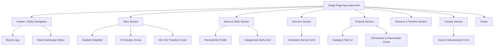
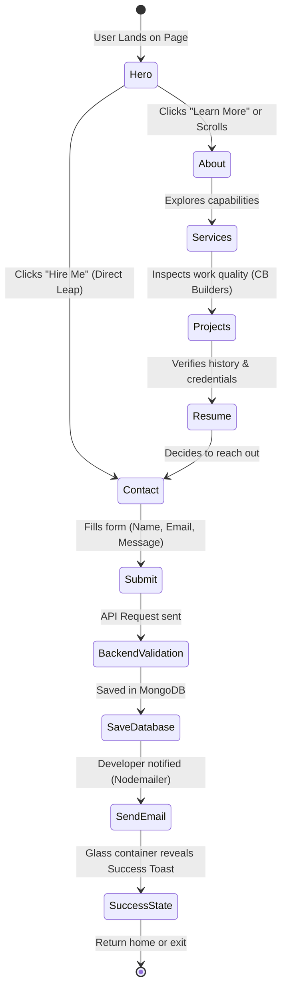

# MASTER DESIGN SYSTEM & PLANNING SYSTEM
**Portfolio Project for Sudalaimuthu A — Full Stack Web Developer**

This document establishes the UI/UX framework, structural hierarchy, design tokens, architecture, and coding guidelines. This serves as the single source of truth for the implementation phase.

---

## 1. COMPLETE PROJECT ARCHITECTURE & FILE STRUCTURE

To optimize deployment (Frontend on Netlify, Backend on Render), the codebase is organized as a decoupled monorepos-style structure within a single repository.

```
d:\New folder (8)\
├── docs/
│   └── design_system_and_planning.md    # Design system specifications
├── frontend/                            # Frontend Static Module (Netlify)
│   ├── index.html                       # Entry HTML document
│   ├── css/
│   │   ├── style.css                    # Main stylesheet containing design system & components
│   │   └── reset.css                    # Standard CSS reset (Modern box model reset)
│   ├── js/
│   │   ├── main.js                      # UI interactions, Scroll triggers, Form submit
│   │   └── validation.js                # Frontend form validator
│   └── assets/
│       ├── icons/                       # Reusable SVG files
│       ├── images/                      # Optimized webp project screenshots & headshot
│       └── documents/                   # Resume / CV PDF
└── backend/                             # Express REST API Backend (Render)
    ├── server.js                        # Express server entry point
    ├── config/
    │   └── db.js                        # Mongoose / MongoDB Atlas connection setup
    ├── models/
    │   └── Contact.js                   # Mongoose schema for Contact Submissions
    ├── routes/
    │   └── api.js                       # API Endpoints (POST /api/contact)
    ├── middleware/
    │   ├── security.js                  # Helmet, CORS, and Express-Rate-Limit Setup
    │   └── errorHandler.js              # Global API Error Handling
    ├── .env.example                     # Environment configuration template
    ├── .gitignore                       # Node modules & secrets ignore pattern
    └── package.json                     # Node.js dependencies configuration
```

---

## 2. REUSABLE DESIGN TOKENS (CSS VARIABLE SPECIFICATION)

These design tokens will be declared in the `:root` pseudo-class in `style.css` to maintain styling consistency.

```css
:root {
  /* Color Palette - HSL (Hue, Saturation, Lightness) for easy transparency manipulation */
  --bg-base-dark: 224 32% 8%;       /* Very Dark Slate Blue (Main background) - #090d16 */
  --bg-card-dark: 224 32% 12%;      /* Slightly lighter Slate Blue for container bg */
  
  /* Primary Gradients and Accents */
  --color-primary: 217 91% 60%;     /* Digital Blue: #3b82f6 */
  --color-secondary: 271 91% 65%;   /* Royal Violet: #a855f7 */
  --color-accent: 190 90% 50%;      /* Cyber Cyan (Micro-accent/highlights): #06b6d4 */

  /* Text Grays (Lighthouse AAA contrast ratios compliant) */
  --text-primary: 0 0% 96%;         /* Off-white: #f5f5f5 */
  --text-secondary: 218 15% 70%;     /* Slate Muted: #a3b3c9 */
  --text-muted: 218 15% 45%;        /* Darker Muted: #627288 */

  /* Typography System */
  --font-family-sans: 'Outfit', -apple-system, BlinkMacSystemFont, "Segoe UI", Roboto, sans-serif;
  --font-family-mono: 'JetBrains Mono', SFMono-Regular, Consolas, monospace;

  /* Font Weights */
  --font-weight-regular: 400;
  --font-weight-medium: 500;
  --font-weight-semibold: 600;
  --font-weight-bold: 700;

  /* Font Sizes (Fluid Typography using clamp) */
  --fs-xs: clamp(0.75rem, 0.7rem + 0.25vw, 0.875rem);   /* 12px - 14px */
  --fs-sm: clamp(0.875rem, 0.8rem + 0.38vw, 1rem);      /* 14px - 16px */
  --fs-base: clamp(1rem, 0.95rem + 0.5vw, 1.125rem);    /* 16px - 18px */
  --fs-md: clamp(1.125rem, 1.05rem + 0.75vw, 1.25rem);  /* 18px - 20px */
  --fs-lg: clamp(1.25rem, 1.15rem + 1vw, 1.5rem);       /* 20px - 24px */
  --fs-xl: clamp(1.5rem, 1.35rem + 1.5vw, 2rem);        /* 24px - 32px */
  --fs-xxl: clamp(2rem, 1.75rem + 2.5vw, 3rem);         /* 32px - 48px */
  --fs-display: clamp(2.5rem, 2rem + 4vw, 4.5rem);      /* 40px - 72px */

  /* Spacing System (8px Baseline Grid) */
  --space-1: 0.25rem;  /* 4px */
  --space-2: 0.5rem;   /* 8px */
  --space-3: 0.75rem;  /* 12px */
  --space-4: 1rem;     /* 16px */
  --space-6: 1.5rem;   /* 24px */
  --space-8: 2rem;     /* 32px */
  --space-12: 3rem;    /* 48px */
  --space-16: 4rem;    /* 64px */
  --space-24: 6rem;    /* 96px */
  --space-32: 8rem;    /* 128px */

  /* Border Radii */
  --radius-sm: 6px;
  --radius-md: 12px;
  --radius-lg: 20px;
  --radius-xl: 30px;
  --radius-full: 9999px;

  /* Transitions */
  --transition-fast: 0.2s cubic-bezier(0.16, 1, 0.3, 1);
  --transition-normal: 0.4s cubic-bezier(0.16, 1, 0.3, 1);
  --transition-slow: 0.6s cubic-bezier(0.16, 1, 0.3, 1);

  /* Elevation (Glow & Box Shadows) */
  --shadow-sm: 0 2px 8px rgba(0, 0, 0, 0.4);
  --shadow-md: 0 8px 30px rgba(0, 0, 0, 0.5);
  --shadow-lg: 0 20px 50px rgba(0, 0, 0, 0.7);
  --shadow-glow-blue: 0 0 30px hsla(var(--color-primary) / 0.15);
  --shadow-glow-purple: 0 0 30px hsla(var(--color-secondary) / 0.15);
  
  /* Glassmorphism Presets */
  --glass-bg: hsla(var(--bg-card-dark) / 0.5);
  --glass-border: hsla(var(--text-primary) / 0.05);
  --glass-backdrop-blur: blur(12px) saturate(180%);
}
```

---

## 3. UI/UX STRATEGY & VISUAL THEMES

### Glassmorphism Rules
To ensure the website remains legible, accessible, and fast, we enforce three primary rules:
1. **Never layer glass on glass**: Avoid rendering overlapping glassmorphic containers. Multiple blur calculations degrade scrolling performance on mobile devices.
2. **Background Contrast**: Place a semi-opaque background layer underneath text to ensure that content achieves the 4.5:1 color contrast ratio over background gradients.
3. **Double-border effect**: Highlight borders with a subtle gradient (top left light, bottom right dark) to mimic 3D glass edges.

### Buttons & Inputs Spec
- **Primary Button**: Transparent glass center with a solid gradient border (Blue to Purple) that transitions into a solid filled background with a glow effect on hover.
- **Secondary Button**: Minimal design, underlined accent with an arrow key micro-animation `(->)` translating rightwards on hover.
- **Form Inputs**: Semi-transparent dark background, rounded borders. When focused, the border transitions to the primary blue color, accompanied by a glowing background effect.

### Shadow & Elevation
Using standard box shadows can make dark interfaces look flat. We implement HSL-based glow shadows:
- Default Cards: `box-shadow: var(--shadow-md), 0 0 1px var(--glass-border);`
- Active/Hover state: `box-shadow: var(--shadow-lg), var(--shadow-glow-blue);`

---

## 4. ACCESSIBILITY (A11Y) & RESPONSIVE LAYOUTS

### Breakpoints (Mobile-First Layout)
Styles will be written mobile-first (`min-width` queries) to simplify DOM rendering:
- **Mobile (Base)**: `width: 100%; padding: 0 var(--space-4);`
- **Tablet (`@media (min-width: 768px)`)**: Two-column layout grid, larger spacing tags.
- **Desktop (`@media (min-width: 1024px)`)**: Dynamic grids, side-by-side components.
- **Max Container (`@media (min-width: 1440px)`)**: Max width locked at `1280px` for optimal readability.

### Accessibility Safeguards
- **Aria-Labels**: Form elements, social icons, and modal buttons will utilize descriptive aria-labels.
- **Color Contrast**: Base text color is `#f5f5f5` on `#090d16`, yielding a contrast ratio of >13:1, easily passing WCAG AAA standards.
- **Focus Indicators**: Interactive links/buttons will render a clear cyan outline on keyboard navigation (`:focus-visible`).

---

## 5. WEBSITE SECTION & COMPONENT HIERARCHY

The web application contains a single-page landing structure divided into these structural blocks:



---

## 6. ANIMATION & MICRO-INTERACTION SCHEDULING

To maintain 60 FPS, all animations are restricted to GPU-accelerated properties (`opacity` and `transform`).

| Trigger | Element | Animation Behavior | CSS / JS Method |
| :--- | :--- | :--- | :--- |
| **Page Load** | Hero Content | Fade Up & Slide (Y: 30px to 0px) | CSS Keyframes (delay: 0.2s) |
| **Scroll Reveal** | Cards / Sections | Opacity (0 to 1), Scale (0.95 to 1) | Intersection Observer API |
| **Hover** | Project / Service Cards | Card Lift (TranslateY: -8px) + Ambient Glow | CSS transition / transform |
| **Hover** | CTA Buttons | Gradient slide/glow expansion | CSS transition |
| **Input Focus** | Contact Form fields | Border transition + Soft background glow | CSS transition |
| **Form Submit** | Submit Button | Spinner reveal, disabled state | JS DOM toggle |

---

## 7. USER JOURNEY & NAVIGATIONAL FLOW

This map shows how we guide high-intent users (clients and companies) toward taking action:



---

## 8. SEO PLANNING & PERFORMANCE OPTIMIZATION

### Technical SEO
- **Semantic Structure**: Proper utilization of `<header>`, `<main>`, `<section>`, `<article>`, and `<footer>` tags. Only one `<h1>` per page.
- **JSON-LD Schema**: Structured schema markup embedded in the `<head>` of the page to present the developer's entity to search engines:
  ```html
  <script type="application/ld+json">
  {
    "@context": "https://schema.org",
    "@type": "Person",
    "name": "Sudalaimuthu A",
    "jobTitle": "Full Stack Web Developer",
    "url": "https://sudalaimuthu.dev",
    "telephone": "+916382539787",
    "email": "sudalaimuthusudalai754@gmail.com",
    "sameAs": [
      "https://github.com/thronmuthu18"
    ]
  }
  </script>
  ```
- **Meta Tags**: Optimized meta-descriptions, Open Graph (OG) tags for LinkedIn/GitHub links sharing, and canonical links.

### Performance Planning (Targeting Lighthouse >95)
1. **Critical CSS**: Load styling variables inline in the `<head>` to prevent Flash of Unstyled Content (FOUC).
2. **Font Loading**: Utilize `font-display: swap` on Google Fonts to ensure text displays immediately while the premium font finishes loading.
3. **No Heavy Frameworks**: Write vanilla JavaScript for logic instead of loading heavy JS bundles.
4. **Optimized Assets**: Project screenshots must be converted to `.webp` format, compressed, and configured with lazy loading (`loading="lazy"`).
